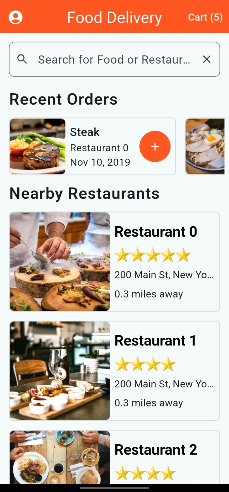
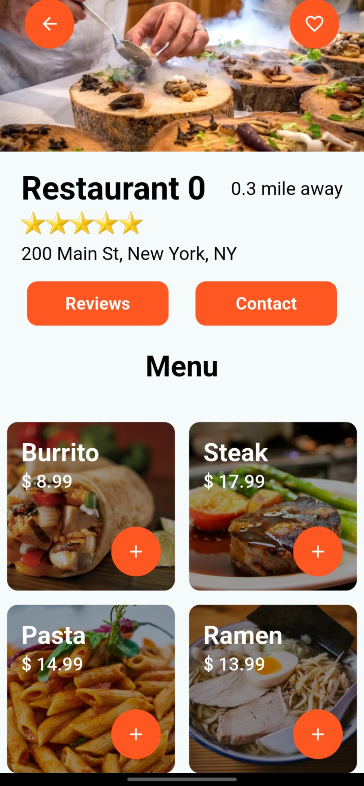
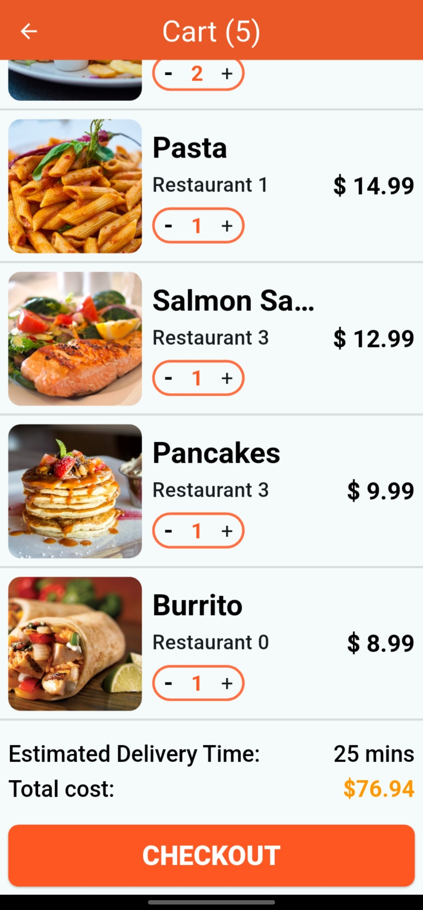

# 🍔 Eat - Food Delivery Mobile Application

A clean and interactive food delivery mobile application built using **Flutter** and **Dart**. Designed to deliver a smooth user experience for browsing nearby restaurants, exploring custom menus, managing shopping carts, and tracking recent orders.

---

## ✨ Key Features
* **Restaurant Discovery:** Browse nearby restaurants equipped with ratings, addresses, and distance metrics.
* **Interactive Menus & Categories:** Explore food items, prices, and high-quality imagery effortlessly.
* **Shopping Cart & Checkout:** Dynamically manage item quantities, calculate total costs in real time, and process orders.
* **Recent Orders Tracking:** Quick access to review past orders and re-order favorites.
* **Clean UI & Navigation:** Enhanced with smooth transitions, custom buttons, and material design.

---

## 📱 App Screenshots

| Home & Recent Orders | Nearby Restaurants | Menu & Food Details |
| :---: | :---: | :---: |
|  |  |  |

---

## 🛠️ Tech Stack & Architecture
* **Framework:** Flutter
* **Programming Language:** Dart
* **UI Components:** ListView (Horizontal & Vertical), GridView, Custom Floating Action Buttons, Material Design, Hero Animations.
* **State Management:** Stateful Widgets & Clean Architecture separating Models, Data sources, and Views.

---

## 🚀 How to Run
1. Ensure you have the **Flutter SDK** installed.
2. Clone this repository or download it as a ZIP.
3. Open the project folder in **VS Code** or **Android Studio**.
4. Run `flutter pub get` to fetch required dependencies.
5. Connect a device or start an emulator and run:
   ```bash
   flutter run
